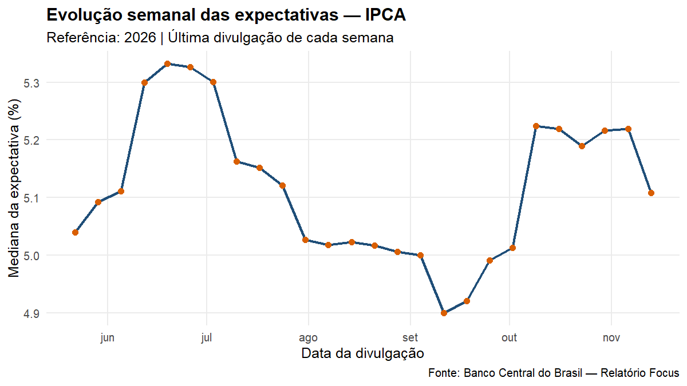
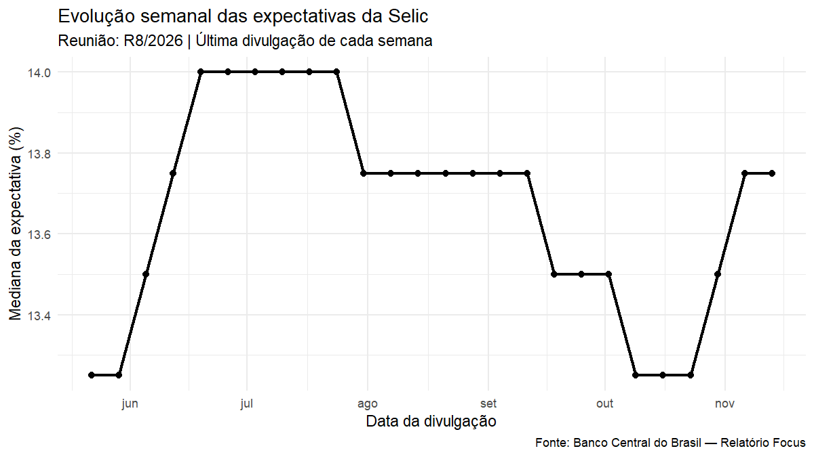
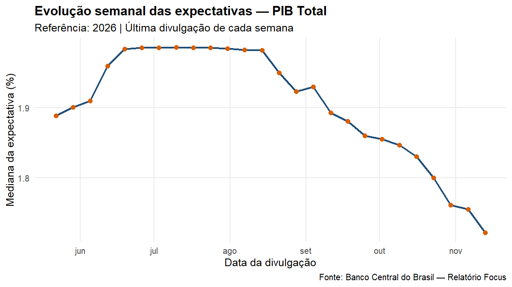
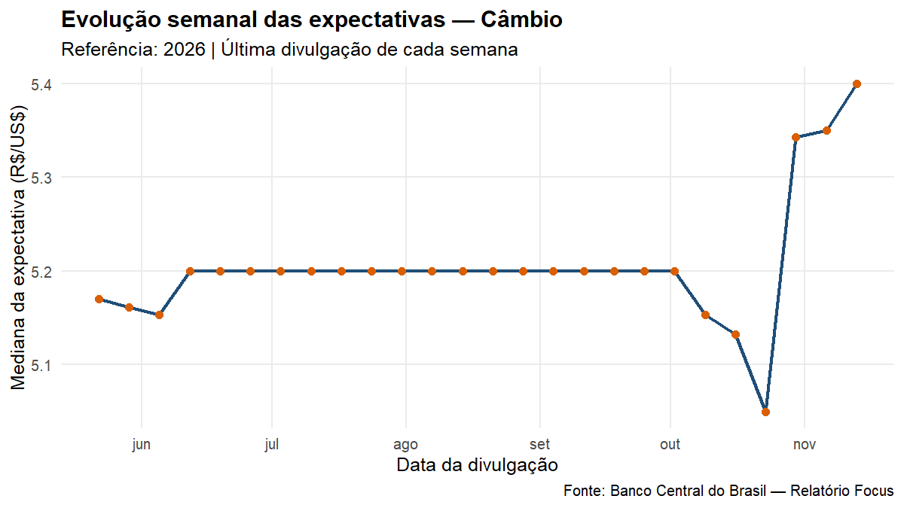

# Aviso Semanal Focus

Projeto desenvolvido para a disciplina **REC3302 — Introdução a R**, da Faculdade de Economia, Administração e Contabilidade de Ribeirão Preto (FEA-RP/USP).

## 1. Sobre o projeto

O Aviso Semanal Focus coleta as expectativas de mercado divulgadas pelo Banco Central do Brasil (Relatório Focus) e compara a divulgação mais recente com a da semana anterior, para responder à pergunta: **o que mudou nas expectativas desta semana?**

O projeto tem caráter aplicado e didático. Ele não estima modelos nem faz previsões próprias: apenas organiza e compara as expectativas já divulgadas pelo Banco Central.

O produto final é o **boletim em Quarto** (`boletim_focus.qmd`, renderizado em `boletim_focus.html`), com texto automático, tabela comparativa e gráficos de evolução semanal para **IPCA, Selic, PIB Total e Câmbio**.

**Boletim online:** https://marianaaraujo231006-hub.github.io/aviso-semanal-focus/

## 2. Fonte dos dados

Os dados vêm do Sistema Expectativas de Mercado do Banco Central do Brasil, pelo pacote `rbcb` e pela função `get_market_expectations()`.

Indicadores e períodos de referência:

- **IPCA:** expectativa para o ano de 2026 (parâmetro `ano_ref`).
- **PIB Total:** expectativa para o ano de 2026 (parâmetro `ano_ref`).
- **Câmbio:** expectativa para o ano de 2026 (parâmetro `ano_ref`), em R$/US$.
- **Selic:** expectativa para a **próxima reunião do Copom**, escolhida automaticamente pelo código. É a reunião mais próxima no calendário entre as que ainda têm expectativas atualizadas. Quando uma reunião acontece, o código passa a usar a seguinte, sem alteração manual.

Todas as análises usam `baseCalculo == 0`, para manter a comparabilidade.

## 3. Estrutura do projeto

```
aviso-semanal-focus/
├── 00_exploracao.R
├── 01_coleta.R
├── 02_tratamento.R
├── 03_visualizacao.R
├── 04_boletim.R
├── boletim_focus.qmd
├── boletim_focus.html
├── README.md
├── R/
│   └── funcoes.R
├── dados/
│   ├── ipca_raw.csv
│   ├── selic_raw.csv
│   ├── pib_raw.csv
│   └── cambio_raw.csv
└── saidas/
    ├── comparacao_semanal.csv
    ├── tabela_comparativa.html
    ├── grafico_ipca.png
    ├── grafico_selic.png
    ├── grafico_pib.png
    └── grafico_cambio.png
```

- `00_exploracao.R`: exploração da estrutura dos dados e verificações de qualidade (valores faltantes, repetições, intervalos entre datas, reuniões do Copom ainda ativas). Não é necessário para gerar o aviso.
- `01_coleta.R`: consulta o Banco Central e grava os dados brutos em `dados/`.
- `02_tratamento.R`: lê os dados brutos, compara as duas últimas semanas de cada indicador e grava a tabela final em `saidas/comparacao_semanal.csv`.
- `03_visualizacao.R`: lê a tabela de comparação e gera a tabela formatada e os gráficos de evolução semanal em `saidas/`.
- `04_boletim.R`: lê a tabela de comparação e gera o texto automático do boletim (abertura e uma frase por indicador) com `glue()`. É chamado pelo `boletim_focus.qmd`.
- `boletim_focus.qmd`: documento Quarto que reúne os destaques da semana, a tabela comparativa, os gráficos e a metodologia. Gera o `boletim_focus.html`, que pode ser aberto direto no navegador.
- `R/funcoes.R`: funções compartilhadas entre os scripts (leitura das bases, escolha da reunião da Selic, comparação entre semanas, gráficos e tabela formatada).
- `dados/`: bases brutas, sem alterações em relação ao que o Banco Central devolveu.
- `saidas/`: resultados do tratamento e da visualização, que alimentam o documento em Quarto.

## 4. Metodologia de comparação

1. Para cada indicador, o código seleciona a **última divulgação de cada semana** (semana ISO) e fica com as **duas semanas mais recentes**.
2. As duas divulgações precisam ser **consecutivas**. Se houver menos de duas semanas disponíveis, ou se as datas estiverem a mais de 10 dias uma da outra, o código emite um aviso e **não faz a comparação**.
3. A variação é a diferença entre as medianas, calculada com `lag()`:

   **Variação = Mediana atual − Mediana anterior**

4. A classificação usa um limite de estabilidade (coluna `Limiar` da tabela de saída):
   - **taxas (IPCA, Selic e PIB Total):** 0,05 ponto percentual (parâmetro `limiar_taxas`);
   - **câmbio:** R$ 0,02 (parâmetro `limiar_cambio`).

   Resultado:
   - **subiu:** variação maior que o limite;
   - **caiu:** variação menor que o limite negativo;
   - **estável:** variação entre o limite negativo e o positivo, inclusive.

A variação é arredondada em 4 casas decimais antes da classificação, para evitar erros de arredondamento do computador.

## 5. Resultado da execução

Comparação entre as divulgações de 6 e 13 de novembro de 2026:

| Indicador | Referência | Mediana anterior | Mediana atual | Variação | Tendência |
|---|---|---:|---:|---:|---|
| IPCA | 2026 | 5,2195% | 5,1082% | −0,1113 p.p. | caiu |
| Selic | R8/2026 | 13,75% | 13,75% | 0,0000 p.p. | estável |
| PIB Total | 2026 | 1,7546% | 1,7215% | −0,0331 p.p. | estável |
| Câmbio | 2026 | R$ 5,3500 | R$ 5,4000 | +R$ 0,0500 | subiu |

Estes números correspondem à execução registrada acima e podem não refletir as expectativas mais recentes. Para atualizar, execute os scripts novamente (seção 7).

Evolução semanal das expectativas (últimos 180 dias, última divulgação de cada semana):

<table>
  <tr>
    <td></td>
    <td></td>
  </tr>
  <tr>
    <td></td>
    <td></td>
  </tr>
</table>

## 6. Validação

A lógica foi testada com semanas passadas, usando `data_corte <- "2026-10-23"`. Na comparação entre 16 e 23 de outubro de 2026, o IPCA 2026 passou de 5,2190% para 5,1891% (variação de −0,0299 p.p., classificada como estável), valores iguais aos da primeira versão do projeto. Nessa data, a reunião da Selic escolhida foi a `R7/2026`.

A conferência dos números com o site do Banco Central será feita na etapa de validação do projeto.

## 7. Requisitos e como executar

Só o `01_coleta.R` precisa de internet. As demais etapas rodam offline com os dados já salvos em `dados/`. Os pacotes usados em cada etapa:

| Etapa | Pacotes |
|---|---|
| `01_coleta.R` | `rbcb`, `dplyr` |
| `02_tratamento.R` | `dplyr` |
| `03_visualizacao.R` | `dplyr`, `gt`, `ggplot2` |
| `04_boletim.R` e `boletim_focus.qmd` | `dplyr`, `glue`, `gt` |

Instale os pacotes uma vez, no Console do R:

```r
install.packages(c("rbcb", "dplyr", "glue", "gt", "ggplot2"))
```

Execute os scripts a partir da pasta do projeto, nesta ordem:

```r
source("01_coleta.R")         # coleta e salva os dados em dados/
source("02_tratamento.R")     # compara as semanas e salva em saidas/
source("03_visualizacao.R")   # gera a tabela formatada e os gráficos
source("04_boletim.R")        # imprime o texto automático no Console
```

Depois, abra o `boletim_focus.qmd` e clique em **Render** (ou rode `quarto::quarto_render("boletim_focus.qmd")` no Console) para gerar o `boletim_focus.html`.

Quem só quiser gerar o aviso com os dados que já estão no repositório pode pular o `01_coleta.R` e não precisa do pacote `rbcb`.

Para testar a lógica com uma data passada, edite o parâmetro `data_corte` no início do `02_tratamento.R` (por exemplo, `"2026-10-23"`). Com `NULL`, o script usa a última data disponível. Os demais parâmetros (`ano_ref`, `limiar_taxas`, `limiar_cambio`) ficam no mesmo bloco.

Se o `04_boletim.R` avisar que a tabela em `saidas/` é de uma versão antiga, rode o `02_tratamento.R` de novo. Se avisar que faltam gráficos, rode o `03_visualizacao.R`.

## 8. Observações sobre os dados

- A base do IPCA tem uma coluna `IndicadorDetalhe` que vem vazia da fonte. Ela não é usada.
- As bases contêm uma linha por dia útil. Nas verificações realizadas (`00_exploracao.R`), não há linhas repetidas nem semanas sem divulgação.

## 9. Evolução do projeto

O projeto foi construído de forma incremental, conforme a proposta inicial:

1. **Definição e ambiente:** pergunta de investigação, indicadores e repositório no GitHub.
2. **Coleta e exploração:** coleta via `rbcb` e verificação da estrutura dos dados.
3. **Tratamento e comparação:** variação semanal com `lag()` e classificação em subiu, caiu ou estável.
4. **Texto automático e publicação:** frases com `glue()` e boletim em Quarto, com tabela e gráficos. PIB Total e Câmbio foram incorporados à versão inicial, que tinha só IPCA e Selic.
5. **Validação e entrega:** conferência dos números com o site do Banco Central, tutorial reprodutível e apresentação (em andamento).

## 10. Limitações

- Os limites de estabilidade (0,05 p.p. e R$ 0,02) são provisórios e podem ser revistos após a validação metodológica.
- A comparação cobre apenas a expectativa anual de 2026 (e a próxima reunião do Copom, no caso da Selic).
- A conferência dos números com as publicações oficiais do Banco Central, o tutorial e a apresentação final dependem da última etapa.

## 11. Referências

Banco Central do Brasil. Sistema Expectativas de Mercado — dados do Relatório Focus.

Pacote R `rbcb`: consulta de dados econômicos do Banco Central do Brasil.